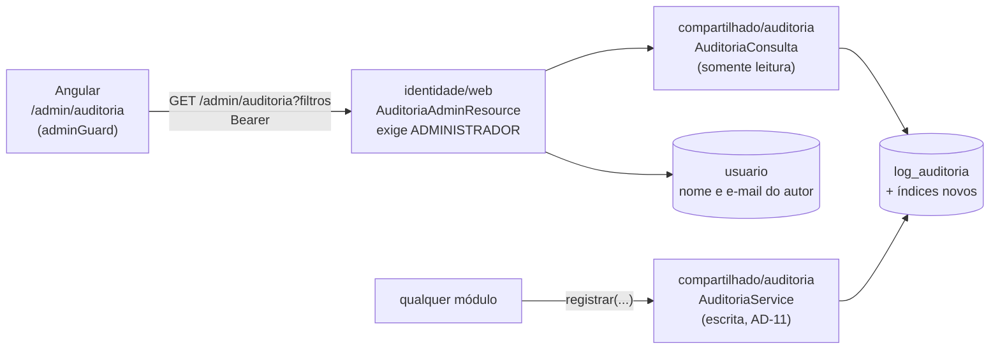

# Decisão: consulta de logs de auditoria pelo administrador

- **Data:** 2026-10-26
- **Estado:** aceita
- **Ticket:** KAN-90
- **Requisitos:** RF83 em [`docs/produto/consulta-de-auditoria.md`](../produto/consulta-de-auditoria.md)
- **Arquitetura:** complementa a AD-11 com o caminho de leitura; AD-1 a AD-10 sem alteração

## Contexto

A AD-11 define como a trilha de auditoria é **gravada**: tabela única `log_auditoria`, escrita só pelo `AuditoriaService` de `compartilhado/`. Não define como ela é **lida**. Hoje a leitura é por `psql`, com credencial do banco e sem controle de acesso por perfil, e a tela só mostra ids (`usuario_id = 3`), não quem é a pessoa.

O time pediu uma tela no painel `/admin` para o administrador consultar os logs, com filtros por módulo, ação, entidade afetada, detalhes e data, paginação de 20 registros e consulta em até 0,5 s.

## Decisão

1. **Tela `/admin/auditoria`, só para `ADMINISTRADOR`.** Fica no painel de administração ao lado de Usuários e Cursos, atrás do `adminGuard`. O backend recusa os outros perfis com 403.
2. **Leitura somente por uma interface de consulta em `compartilhado/auditoria`.** Entra `AuditoriaConsulta` (somente leitura: filtros, paginação e valores distintos para as opções), ao lado do `AuditoriaService` (escrita). Nenhum módulo lê `log_auditoria` direto, assim como nenhum escreve direto.
3. **Endpoint em `identidade/web`.** `GET /admin/auditoria` e `GET /admin/auditoria/filtros` ficam em Identidade, onde já mora a administração de plataforma (`/admin/painel`, `/admin/usuarios`, `/admin/cursos`). Identidade usa `AuditoriaConsulta` e completa o autor com nome e e-mail da própria tabela `usuario`. O `compartilhado/` continua sem importar nenhum módulo (AD-3), por isso o nome do autor não pode ser resolvido lá.
4. **Filtros no servidor, não no navegador.** O navegador nunca recebe a tabela inteira; recebe uma página de 20 no `PageResponse`. Filtros vazios são ignorados; módulo, ação e entidade por igualdade; detalhes por "contém" sem diferenciar maiúsculas; data por intervalo de dias no fuso `America/Sao_Paulo`.
5. **Índices para cumprir 0,5 s com 100 mil registros.** Changeset novo na pasta `modulos/infraestrutura/` (onde está a tabela):
   - `(criado_em DESC, id DESC)` para a ordem padrão e o filtro de data (substitui o índice simples atual de `criado_em`);
   - `(modulo, acao, criado_em DESC)` para os filtros de módulo e ação;
   - `(entidade_afetada, criado_em DESC)`;
   - GIN com `gin_trgm_ops` em `detalhes`, para o "contém" (`ILIKE '%texto%'`) usar índice. Exige a extensão `pg_trgm`, disponível no Postgres 16 do Dev Services e no Neon. O mínimo de 3 caracteres no filtro existe porque o trigrama não ajuda com menos.
6. **Consultar não é auditado.** Cada mudança de filtro viraria um registro e a trilha se encheria das próprias consultas. O acesso já é restrito ao administrador.
7. **Visual no padrão do KAN-84.** A tela é feita depois dos tokens e componentes novos de `ui/`. Por isso o ticket nasce bloqueado pelo ticket de implementação "casca, tokens e `ui/`" do redesign.

## Alternativas consideradas

| Alternativa | Por que não |
|---|---|
| Continuar com `psql` e console do Neon | Exige credencial do banco, não tem controle por perfil e não mostra quem é o autor. |
| Ferramenta externa (Metabase, Grafana) | Mais um serviço para hospedar e proteger, fora do plano gratuito, e um acesso ao banco paralelo à aplicação. |
| Filtrar no navegador, carregando tudo | Não escala e não cumpre 0,5 s quando a tabela crescer; expõe mais dados que o necessário. |
| Busca textual completa (`tsvector`) em detalhes | Bom para frases, ruim para os códigos e ids que os detalhes guardam (`cursoId=27`, `ALUNO -> MODERADOR`). Trigrama dá "contém" previsível. |
| Módulo novo `administracao` para o endpoint | A administração de plataforma já mora em Identidade; abrir um pacote só para isso foge da AD-3 (12 módulos). Revisitar se a administração crescer. |
| Auditar cada consulta | Polui a trilha com o próprio uso; ver item 6. |

## Consequências

- A AD-11 em `docs/arquitetura.md` ganha uma frase sobre leitura: "leitura só pela interface `AuditoriaConsulta`, somente leitura, consumida pela administração de plataforma".
- O banco de produção (Neon) passa a ter a extensão `pg_trgm`, criada pelo changeset.
- Os índices novos deixam a gravação de cada log um pouco mais cara. Com o volume do projeto, o impacto é desprezível.
- A tabela continua crescendo sem limite. Retenção e exportação ficam fora deste escopo; registrar como dívida técnica quando o volume preocupar.
- O ticket fica bloqueado até a implementação dos tokens e de `ui/` do KAN-84, que por sua vez depende da aprovação da direção visual.
