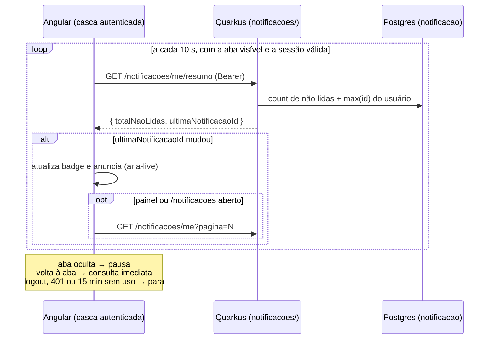

# Decisão: lista, leitura, exclusão e atualização automática das notificações

- **Data:** 2026-10-26
- **Estado:** proposta (aguarda o aceite de João Pedro, responsável pelo módulo Notificações)
- **Ticket:** KAN-46 (Story 10.2, RF68 e RF69), com regras de negócio, requisitos e critérios de aceite na descrição do ticket
- **Requisito novo:** RF84 "Excluir notificação" (estende a numeração do `prd.md`, depois do RF83 do KAN-90)
- **Altera:** a parte de frontend de [`2026-09-30-notificacoes-e-onboarding.md`](2026-09-30-notificacoes-e-onboarding.md) (sininho como item da sidebar com dropdown)
- **Arquitetura (AD-1 a AD-11):** sem alteração

## Contexto

A Story 10.1 (KAN-41) entregou o módulo `notificacoes/` com `GET /notificacoes/me` (paginado) e `POST /notificacoes/{id}/lida`, e um item "Notificações" na sidebar que abre um dropdown. A Story 10.2 pede marcar como lida e listar **todas** as notificações. Na análise do que está no main apareceram estas lacunas:

1. O badge conta as não lidas no front, só sobre a 1ª página (20 itens). Com mais de 20 notificações, a contagem fica errada.
2. O dropdown mostra só as 20 primeiras e não oferece como ver o resto, então o RF69 não é atendido.
3. O parâmetro `tamanho` não tem limite.
4. Não existe "marcar todas como lidas".
5. A lista só é atualizada ao abrir o painel: uma notificação nova não aparece sozinha.
6. Estava pendente desde o KAN-41 a escolha entre o "modal com a lista completa" que o ticket pede e o dropdown que foi entregue.

Neste mesmo dia o time pediu três mudanças: permitir excluir notificação, tirar o acesso às notificações da sidebar e levá-lo para um sininho ao lado do avatar, e mostrar as notificações em tempo real.

## Decisão

1. **Sininho ao lado do avatar, fora da sidebar.** O item "Notificações" sai da sidebar, da gaveta mobile e da tabbar. Um botão de sino fica imediatamente à esquerda do avatar, visível em qualquer largura, e abre um painel. A regra é "ao lado do avatar onde quer que ele esteja". Na casca atual isso é a barra superior. Na casca do KAN-84 é o rodapé da sidebar no desktop e o cabeçalho no mobile. O painel do sininho e o menu da conta nunca ficam abertos juntos.
2. **Painel curto + página `/notificacoes`.** O painel mostra as 5 mais recentes, "Marcar todas como lidas", "Excluir" por item e o link "Ver todas". A lista completa fica na página `/notificacoes`: 20 por página, mais recentes primeiro, não lidas destacadas sem reordenar, página na URL. Não se cria um componente Modal genérico em `ui/`.
3. **Contagem de não lidas vem do backend.** `GET /notificacoes/me` passa a devolver `totalNaoLidas`. O badge nunca conta sobre a página carregada. `tamanho` é limitado a 20.
4. **Marcar todas como lidas.** `POST /notificacoes/me/lidas` marca as não lidas criadas até o momento da chamada. Marcar uma já lida continua idempotente (204).
5. **Exclusão física, uma por vez, sem confirmação.** `DELETE /notificacoes/{id}` apaga a linha. A exclusão vale para notificações lidas e não lidas e não pode ser desfeita. O front mostra o toast "Notificação excluída." e trata 404 como sucesso. Excluir não impede que o emissor gere outra notificação do mesmo tipo: o aviso de onboarding volta no próximo login enquanto o perfil estiver incompleto.
6. **"Tempo real" por consulta periódica de 10 s.** Enquanto a casca autenticada está aberta, o front chama `GET /notificacoes/me/resumo`, que devolve só `{ totalNaoLidas, ultimaNotificacaoId }`. Quando o id muda, o badge é atualizado, e a lista é recarregada se o painel ou a página estiverem abertos. O atraso máximo aceito é de ~10 s.
7. **A consulta periódica é contida para caber no plano gratuito.** O backend roda num Render Web Service free e o banco no Neon free, e os dois dormem sem uso e têm limite mensal de horas. Uma consulta sem freio manteria os dois acordados indefinidamente. Por isso a consulta:
   - **pausa com a aba oculta** (Page Visibility API) e consulta na hora quando a aba volta a ficar visível;
   - **não conta como atividade** para a sessão do KAN-78, então uma aba esquecida expira em 15 min e a consulta para junto;
   - para no logout e em qualquer 401;
   - nunca se sobrepõe: se a anterior não respondeu, pula o ciclo;
   - em erro de rede ou 5xx, faz backoff de 10 s a 60 s, sem avisar o usuário.
8. **Nada disso é auditado.** Marcar, excluir e consultar não gravam em `log_auditoria`: notificação é dado do próprio usuário, e auditar a consulta de 10 s poluiria a trilha.
9. **Posse sempre verificada no backend.** Toda operação filtra por `id` + `usuario_id` do token. Notificação de outro usuário devolve 404, para não revelar que ela existe (AD-5).
10. **Anúncio acessível.** Quando o total de não lidas aumenta, o leitor de tela anuncia uma vez, por `aria-live="polite"`, sem mudar o foco.



### Contrato (detalhe final no PR de contrato, AD-4)

```
GET    /notificacoes/me?pagina=0&tamanho=20   200 PageResponse<NotificacaoResponse> + totalNaoLidas · 401
GET    /notificacoes/me/resumo                200 { totalNaoLidas, ultimaNotificacaoId | null } · 401
POST   /notificacoes/{id}/lida                204 · 401 · 404 NOTIFICACAO_NAO_ENCONTRADA
POST   /notificacoes/me/lidas                 204 · 401
DELETE /notificacoes/{id}                     204 · 401 · 404 NOTIFICACAO_NAO_ENCONTRADA
```

## Alternativas consideradas

| Alternativa | Por que não |
|---|---|
| Push de verdade (SSE ou WebSocket) | Exige conexão aberta permanente no Render free, que dorme sem tráfego e reinicia. Para notificação, ~10 s de atraso é aceitável. Fica como próximo passo se o atraso ou a carga incomodarem. |
| Consulta periódica buscando a lista inteira | 20 linhas por usuário a cada 10 s, para quase sempre não mudar nada. O resumo responde com duas agregações sobre índices que já existem. |
| Consulta periódica sem pausar com a aba oculta | Cada aba esquecida manteria o Render e o Neon acordados. Com o uso da turma, isso pode esgotar o limite mensal do plano gratuito e derrubar o sistema para todos. |
| Modal com a lista completa (pedido original do ticket) | Exigiria um componente Modal novo em `ui/`, não tem URL para paginar nem para voltar no navegador, e os mockups do KAN-84 já tratam a lista como um destino de navegação. |
| Manter o acesso na sidebar | Pedido do time: o sininho junto do avatar é o padrão que os usuários conhecem e fica visível também no mobile, sem abrir a gaveta. |
| Exclusão lógica com "Desfazer" | Mais uma coluna e um filtro em toda consulta para uma perda de baixo impacto. Pode ser revisto se excluir por engano virar queixa. |
| Contar não lidas no front | É a causa da lacuna 1. Só o backend sabe o total. |

## Consequências

- **KAN-84:** a casca nova do redesign é implementada primeiro, como está nos mockups de `docs/design/kan-84/` (com "Notificações" na `nav.side` e na `tabbar`). O KAN-46 vem depois e é ele que tira o item da sidebar e da tabbar e põe o sininho ao lado do avatar da casca nova (rodapé da sidebar no desktop, cabeçalho no mobile).
- **Shell atual:** sai `abrePainelNotificacoes` do `NavItem`, e o sininho e o painel vão para a área do avatar na barra superior. Os seletores de `e2e/notificacoes.spec.ts`, `e2e/acessibilidade.spec.ts` e dos testes do shell mudam.
- **Carga:** no pior caso, 6 requisições por minuto por aba ativa e visível, no máximo até 15 min depois da última interação. Nenhum log de aplicação por chamada do resumo.
- **Sessão:** o `SessaoAtividadeService` não muda, porque já considera só eventos do usuário (ponteiro, tecla, rolagem, toque), e não requisições.
- **Abas:** cada aba consulta sozinha. Depois de marcar ou excluir numa aba, as outras se acertam na próxima consulta.
- **Fora do escopo:** agrupamento ("Rafael e mais 4…", Story 10.1), novos tipos de notificação (RF65–RF67), preferências, e-mail, notificação do sistema operacional, som, excluir várias de uma vez e "limpar lidas".
- **`package-info.java` de `notificacoes/`** precisa citar a Story 10.2, o RF84 e os endpoints novos quando o código for feito.
